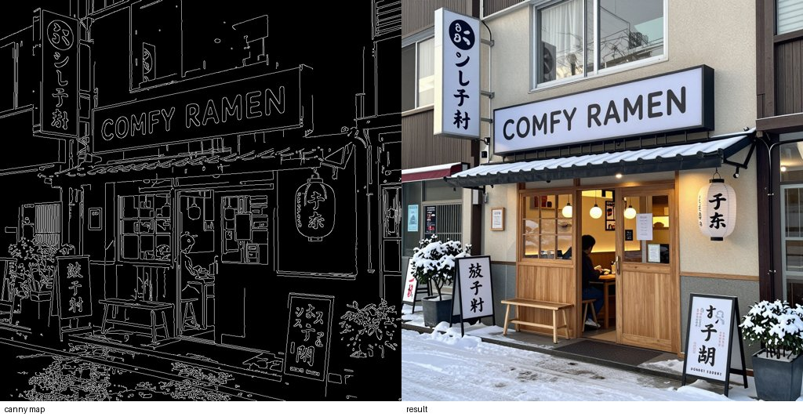
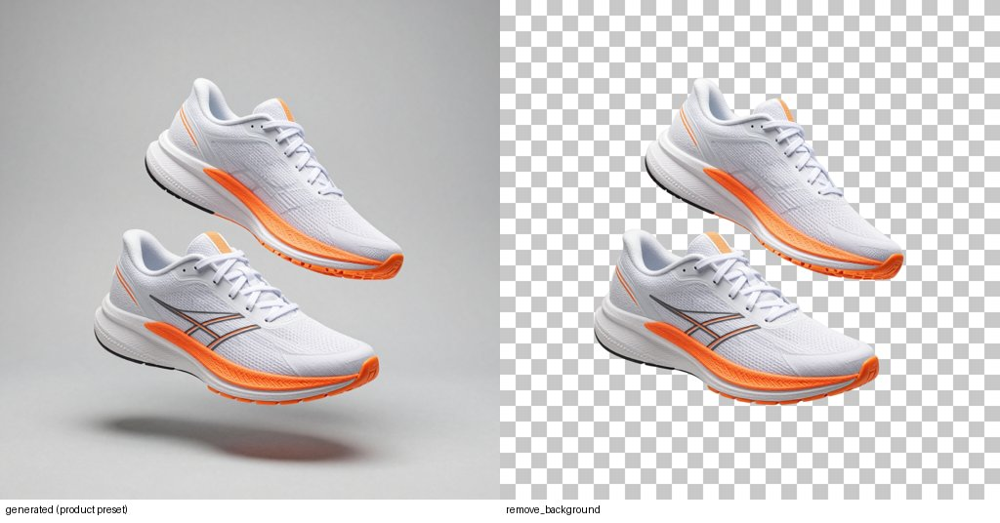

# ComfyClaude

**Give Claude the ability to create and edit images — locally, privately, for free — using your own
[ComfyUI](https://github.com/comfyanonymous/ComfyUI) and [Z-Image Turbo](https://huggingface.co/Tongyi-MAI/Z-Image-Turbo).**

Claude can't generate images on its own. ComfyClaude is a Claude Code plugin that connects Claude to the
ComfyUI running on your PC. Ask in plain language — *"make a poster for my bake sale"*, *"put this product
on a marble table"*, *"give me four logo ideas"* — and Claude writes the prompt, runs the right workflow,
**looks at the result itself**, fixes what's wrong, and hands you the file.

It is tuned to run on modest hardware: everything here was built and benchmarked on a laptop RTX 4050
with 6 GB VRAM and 16 GB RAM.

<p align="center">
  
  
</p>
<p align="center">
  
</p>
<p align="center">
  
  
</p>
<p align="center"><sub>All generated on a 6 GB laptop GPU. Top: text-to-image. Middle: ControlNet (same layout, new scene).
Bottom: outpaint and background removal.</sub></p>

## What it can do

| Tool | What it does |
|---|---|
| `generate_image` | Text → image, 12 style presets, accurate text rendering (signs, posters) |
| `generate_drafts` | Several quick drafts side by side; pick one and finalize it |
| `generate_from_reference` | Use an image as a reference: variations, restyling (img2img) |
| `generate_with_control` | Follow a reference's exact outlines (canny) or a person's pose |
| `inpaint` | Change only part of an image: a region, the subject, or the background |
| `outpaint` | Extend an image beyond its borders (e.g. square → widescreen) |
| `upscale` | 2–4× upscale, optional detail-adding refine pass |
| `remove_background` | Transparent PNG cut-outs |
| `run_custom_workflow` | Run any workflow you export from ComfyUI |
| `list_capabilities`, `job_status`, `comfy_status`, `free_memory` | Utilities |

## How it works

```
 You ──► Claude ──(MCP tools)──► ComfyClaude server ──(HTTP API)──► ComfyUI on your GPU
           ▲                          │  picks workflow + quality,       │
           │                          │  resizes inputs, builds masks    │
           └──── Claude opens the ◄───┴──── image saved to disk ◄────────┘
                 image and checks it
```

- **Plugin** = the package you install. It bundles an **MCP server** (gives Claude the tools) and
  **skills** (teach Claude when to use which tool, how to prompt Z-Image, and to always check its work).
- The server builds ComfyUI workflows in code, so one graph works across all quality tiers.
- It asks ComfyUI which model files exist (`/object_info`), so it works with any install layout.
- If ComfyUI isn't running and you've told it where ComfyUI lives, it starts ComfyUI in the background.
- Every image is saved with a `.json` next to it (prompt, seed, settings, time) so it can be reproduced.

## Requirements

- [Claude Code](https://code.claude.com)
- [ComfyUI](https://www.comfy.org/download) (Desktop, portable, or manual install), recent version
- [uv](https://docs.astral.sh/uv/getting-started/installation/) (runs the server; installs its Python deps automatically) and `git`
- An NVIDIA GPU with **6 GB+ VRAM** and **16 GB+ RAM** recommended. A big pagefile/swap helps on 16 GB.
- Disk: ~11 GB for the default models, ~30 GB for everything

## Install

**1. Install the plugin** (in Claude Code 2.1.275 or later):
```
/plugin install comfyclaude --marketplace DineshBaghelDev/ComfyClaude
```
On older versions:
```
/plugin marketplace add DineshBaghelDev/ComfyClaude
/plugin install comfyclaude@comfyclaude
```

**2. Let Claude set it up.** Just say:
> *"Set up ComfyClaude"*

The setup skill finds your ComfyUI, asks about your GPU, installs the
[ComfyUI-GGUF](https://github.com/city96/ComfyUI-GGUF) node and downloads the right models. Or do it yourself:
```
uv run --directory <plugin folder> python setup_models.py --comfy-path "C:/path/to/ComfyUI" --tiers balanced --extras
```

**3. Configure** (`/plugin` → comfyclaude → configure):
| Setting | Meaning |
|---|---|
| ComfyUI URL | Default `http://127.0.0.1:8188`. ComfyUI Desktop often uses `8000`. |
| ComfyUI folder | Optional. Folder with `main.py` — enables auto-start. |
| Output folder | Optional. Default `~/ComfyClaude/outputs`. |

**4. Restart ComfyUI and try it:** *"Generate a cozy ramen shop at night with a neon sign reading 'COMFY RAMEN'."*

<details>
<summary>Without the plugin system (any MCP client)</summary>

```
git clone https://github.com/DineshBaghelDev/ComfyClaude
cd ComfyClaude
claude mcp add --scope user comfyclaude -- uv run --directory "$PWD" python server.py
```
Set `COMFYUI_URL` / `COMFYUI_PATH` / `COMFYCLAUDE_OUTPUT_DIR` env vars or use `~/.comfyclaude/config.json`.
</details>

## Quality tiers

| Tier | Models | Memory | Use for |
|---|---|---|---|
| `balanced` *(default)* | Z-Image Turbo GGUF Q8 + Qwen3-4B Q8, 8 steps | ~11 GB | Everything. Visually near-identical to `max`. |
| `fast` | same files, 6 steps | same | Drafts and throwaway images (no model reload) |
| `lowmem` | GGUF Q5 | ~8.5 GB | Low RAM. Note: K-quants can sample *slower* on small GPUs. |
| `max` | original bf16 | ~19 GB | Best possible quality; practical with 12 GB+ VRAM / 32 GB RAM |

Claude picks the tier per task (drafts → `fast`, finals → `balanced`) unless you ask for one.

### Which tiers should I install?
| Hardware | Tiers |
|---|---|
| 6–8 GB VRAM, 16 GB RAM | `balanced` |
| 6–8 GB VRAM, 8–12 GB RAM | `lowmem` |
| 12–16 GB VRAM, 32 GB RAM | `balanced,max` |
| 24 GB+ VRAM | `max` (set `default_quality` to `max`) |

### Performance (RTX 4050 Laptop 6 GB, 16 GB RAM, 1024×1024)
| Setup | First image | Next images |
|---|---|---|
| bf16, ComfyUI defaults | 150–330 s | — |
| Q8, ComfyUI defaults | ~155 s | ~125 s |
| **Q8, `--cache-classic --disable-pinned-memory`** | ~135 s | **~90 s** |
| Q8 drafts at 768 px, 6 steps | — | **~20 s** each |

On 16 GB RAM, ComfyUI's default cache evicts the diffusion model every time the text encoder loads, so
every image reloads ~7 GB from disk. ComfyClaude starts ComfyUI with `--cache-classic --disable-pinned-memory`
to keep models loaded. **If you start ComfyUI yourself, add those flags** (ComfyUI Desktop: server launch arguments).
Please share numbers from your GPU in an issue!

## Customize

Everything is overridable in **`~/.comfyclaude/config.json`** — it's merged over
[`config/defaults.json`](config/defaults.json) key by key:

```json
{
  "comfy_path": "D:/ComfyUI",
  "comfy_args": ["--cache-classic", "--disable-pinned-memory", "--extra-model-paths-config", "D:/models.yaml"],
  "default_quality": "max",
  "qualities": {
    "balanced": { "unet": "my-z-image-finetune-Q8_0.gguf" },
    "int8": {
      "description": "Official int8 build",
      "loader": "standard",
      "unet": "z_image_turbo_int8_convrot.safetensors",
      "clip": "qwen_3_4b_fp8_mixed.safetensors"
    }
  },
  "sampler": { "steps": 9 },
  "models": { "upscaler": "RealESRGAN_x4plus.pth" }
}
```

- **Your own tiers / fine-tunes**: add entries to `qualities`. Comfy-Org also publishes
  [int8 and nvfp4 builds](https://huggingface.co/Comfy-Org/z_image_turbo/tree/main/split_files) of Z-Image Turbo
  that may be faster on some GPUs (nvfp4 needs RTX 50-series) — untested here, benchmarks welcome.
- **Style presets**: add `~/.comfyclaude/presets.json` (`{"noir": "Black and white film noir photo, ..."}`).
- **Custom workflows**: in ComfyUI, *Export (API)* a workflow into `~/.comfyclaude/workflows/<name>.json`, and replace
  values Claude should control with placeholders like `"{{prompt}}"`, `"{{seed}}"`, `"{{image}}"`.
  Claude runs it with `run_custom_workflow`. See [`workflows_custom/example_t2i_bf16.json`](workflows_custom/example_t2i_bf16.json).
- **Other models / new tools**: see [CONTRIBUTING.md](CONTRIBUTING.md).

## Troubleshooting

| Problem | Fix |
|---|---|
| "ComfyUI is not running" | Start ComfyUI, check the port in its window, or set the ComfyUI folder for auto-start |
| "ComfyUI-GGUF custom node not installed" | Run setup again or install it via ComfyUI Manager; restart ComfyUI |
| Every image is slow, model reloads | Start ComfyUI with `--cache-classic --disable-pinned-memory` |
| Out of memory | `lowmem` tier, smaller images then `upscale`, close other GPU apps, bigger pagefile |
| Missing model files | `setup_models.py --check`, then download the missing tier/extras |

Logs: `<output folder>/comfy_server.log` (when ComfyClaude started ComfyUI).

## Limitations

- Instruction-style editing ("make the sky red") isn't included: there's no public Z-Image edit model yet,
  and Qwen-Image-Edit / Flux Kontext are heavy for 6–8 GB GPUs. Use `inpaint` or `generate_from_reference`.
- Pose transfer is only as good as the extracted skeleton (limbs hidden by clothing can be missed).
- NVIDIA GPUs are the tested path. AMD/Apple may work through ComfyUI but are untested.

## Models & licenses

ComfyClaude's code is [MIT](LICENSE). Models are downloaded from their authors and keep their own licenses:

| Model | License |
|---|---|
| [Z-Image Turbo](https://huggingface.co/Tongyi-MAI/Z-Image-Turbo) (+ [GGUF](https://huggingface.co/jayn7/Z-Image-Turbo-GGUF)) | Apache-2.0 |
| [Qwen3-4B](https://huggingface.co/unsloth/Qwen3-4B-GGUF) text encoder | Apache-2.0 |
| [Z-Image Turbo Fun ControlNet Union 2.1](https://huggingface.co/alibaba-pai/Z-Image-Turbo-Fun-Controlnet-Union-2.1) | Apache-2.0 |
| [SDPose](https://huggingface.co/Comfy-Org/SDPose), [BiRefNet](https://huggingface.co/Comfy-Org/BiRefNet) | MIT |
| 4x-UltraSharp upscaler | CC BY-NC-SA 4.0 (**non-commercial**) — swap via `models.upscaler` for commercial use |

Thanks to the ComfyUI, ComfyUI-GGUF, Tongyi-MAI and Alibaba PAI teams.
